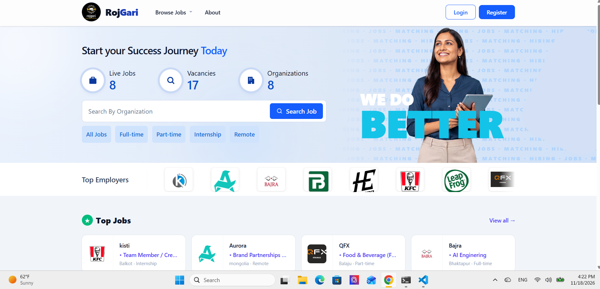
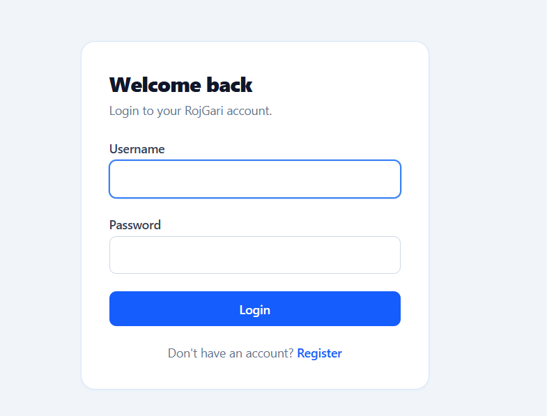
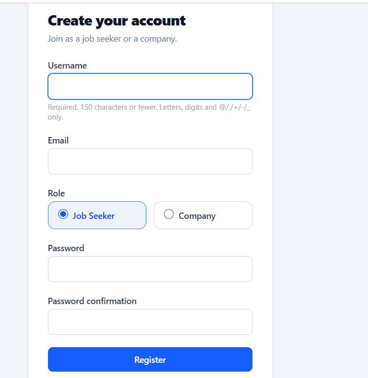
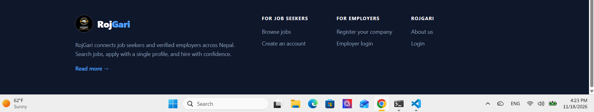
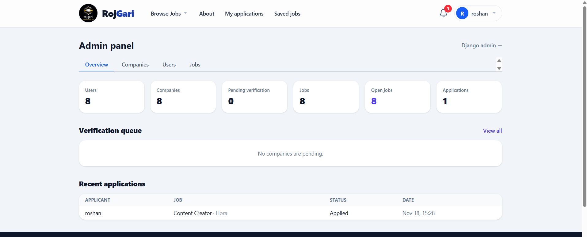
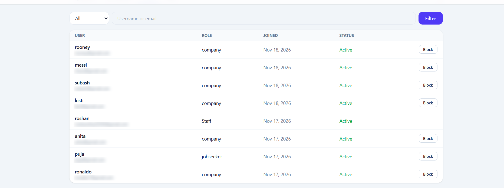
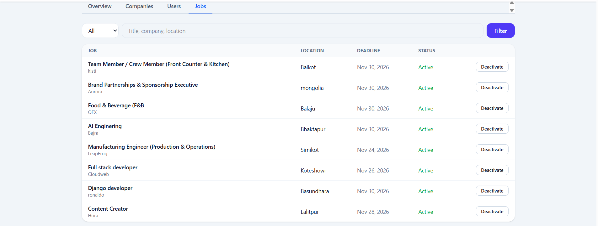
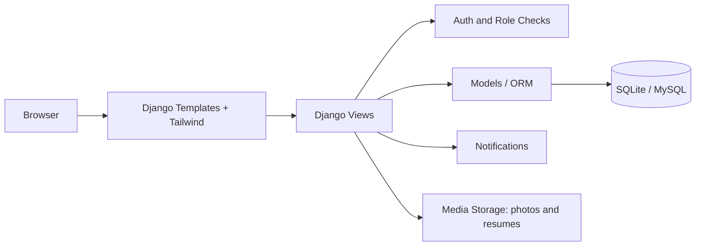
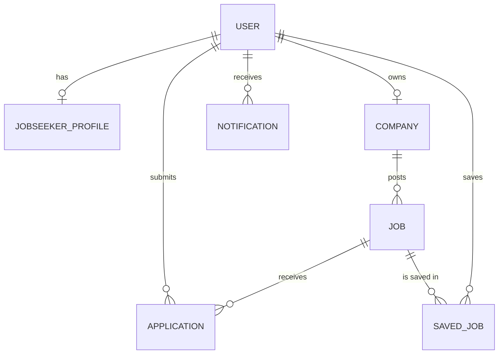

<div align="center">

<h1>RojGari</h1>

<p><b>A role-based job portal for Nepal, connecting job seekers with verified employers.</b></p>

[Screenshots](#screenshots) &nbsp;|&nbsp; [Features](#features) &nbsp;|&nbsp; [Setup](#getting-started)

</div>



**Contents:** [Overview](#overview) | [Highlights](#highlights) | [Screenshots](#screenshots) | [Features](#features) | [Tech stack](#tech-stack) | [Architecture](#architecture) | [Engineering decisions](#engineering-decisions) | [Project structure](#project-structure) | [Getting started](#getting-started) | [Security](#security-practices) | [Testing](#testing) | [Roadmap](#roadmap)

## Overview

RojGari is a full-stack web application with three user roles: **job seekers**, **companies** and **admins**. Job seekers maintain a single profile and resume and apply to jobs. Companies register, are **verified by an admin**, then post jobs and manage applicants. Admins monitor the whole platform from a custom dashboard.

**Why this project:** hiring platforms depend on trust. RojGari adds a company verification step before any job goes live, and keeps every party informed with in-app notifications.

## Highlights

- **Three role-based experiences** (job seeker, company, admin) with separate dashboards and access rules
- **Company verification workflow**: companies are reviewed by an admin before they are trusted on the platform
- **Complete application lifecycle**: apply, track status, receive notifications
- **Account security flows**: email verification (with resend), password reset by email and a lockout page for repeated failed logins
- **Profile strength meter** that guides job seekers to complete their profile
- **Secure resume handling**: resumes are served through a protected view, not exposed as open links
- **Custom admin panel** with live statistics, filters, search and moderation actions (block users, deactivate jobs)
- **Relational data model** that runs on SQLite out of the box and on MySQL 8 when configured
- **Responsive UI** built with Tailwind CSS

## Screenshots

| Login | Register |
| --- | --- |
|  |  |

| Footer |
| --- |
|  |

| Profile and notifications menu | Admin overview |
| --- | --- |
|  |  |

| Admin: user management | Admin: job management |
| --- | --- |
|  |  |

## Features

### Job seekers
- Register, verify email, log in, reset a forgotten password and manage a detailed profile: photo, headline, bio, contact, location, education, experience, skills, expected salary and preferred job type
- Skills displayed as tags
- Upload a resume once and reuse it for every application
- Search jobs by organization and filter by Full-time, Part-time, Internship or Remote
- Save jobs and review them later
- Apply to jobs and track each application under *My applications*
- Notification bell with an unread counter

### Companies
- Separate employer registration and login
- Admin verification before the company is trusted
- Post and manage jobs with location, job type and application deadline
- Review applicants and their resumes
- Update application status
- Get notified when a new application arrives

### Admin
- Overview cards: users, companies, pending verification, jobs, open jobs, applications
- Verification queue for new companies
- Recent applications feed
- **Users:** filter by role, search by username or email, block accounts
- **Jobs:** filter by status, search by title, company or location, deactivate listings
- **Companies:** review and verify companies
- Shortcut to the Django admin

## Tech stack

| Layer | Technology |
| --- | --- |
| Language | Python 3 |
| Framework | Django |
| Database | SQLite (default) or MySQL 8 |
| Frontend | Django Templates, Tailwind CSS |
| Tooling | Git, GitHub, VS Code, npm |

## Architecture



### Data model (simplified)



## Engineering decisions

| Decision | Why |
| --- | --- |
| Split the code into focused apps (`accounts`, `companies`, `jobseeker`, `jobs`, `applications`, `notifications`, `adminpanel`) | Each app owns one responsibility, which keeps models, views and tests easy to find |
| Role checks in reusable decorators (`core/decorators.py`) | One place enforces who can open which page, instead of repeating checks in every view |
| Notification logic in a service module (`notifications/services.py`) | Views stay thin and every event creates notifications the same way |
| A context processor for the unread count | The navbar bell works on every page without extra code in each view |
| Django signals to create profiles (`jobseeker/signals.py`, `companies/signals.py`) | A profile or company record is created automatically when a user registers |
| Upload validators (`core/validators.py`) | Resumes and photos are checked before they are saved |
| Environment-based configuration with a `.env.example` | No secrets in Git, and the database can switch between SQLite and MySQL without code changes |
| Compiled Tailwind CSS committed in `static/css/output.css` | The site is styled right after cloning, without a Node build step |

## Project structure

```
rojgari/
├── accounts/                 # Authentication and user accounts
│   ├── emails.py             # Verification and account emails
│   ├── forms.py              # Registration and login forms
│   ├── signals.py            # Account-related signals
│   ├── models.py             # Custom user model (roles, email verified)
│   ├── views.py, urls.py
│   └── migrations/
├── adminpanel/               # Custom admin panel (overview, companies, users, jobs)
│   ├── views.py, urls.py
│   └── apps.py
├── applications/             # Job applications and status tracking
│   ├── models.py, forms.py
│   ├── views.py, urls.py
│   └── migrations/
├── companies/                # Company profiles and admin verification
│   ├── models.py, forms.py
│   ├── signals.py
│   └── migrations/
├── config/                   # Project configuration
│   ├── settings.py           # Settings (reads values from .env)
│   ├── urls.py               # Root URL routes
│   └── wsgi.py, asgi.py
├── core/                     # Shared utilities
│   ├── decorators.py         # Role-based access decorators
│   ├── validators.py         # File upload validators
│   ├── views.py, urls.py     # Home, about and protected resume access
│   └── models.py
├── dashboard/                # Job seeker and company dashboards
│   ├── views.py, urls.py
│   └── models.py
├── jobs/                     # Job listings, search and saved jobs
│   ├── models.py             # Job and SavedJob
│   ├── forms.py
│   ├── templatetags/         # Custom template filters (job_extras.py)
│   ├── views.py, urls.py
│   └── migrations/
├── jobseeker/                # Job seeker profile
│   ├── models.py, forms.py
│   ├── signals.py            # Creates a profile for new job seekers
│   └── views.py
├── notifications/            # In-app notifications
│   ├── models.py
│   ├── services.py           # Creates notifications for events
│   ├── context_processors.py # Unread count for the navbar bell
│   └── views.py, urls.py
├── templates/                # Django templates
│   ├── base.html
│   ├── accounts/             # Login, register, password reset, verification
│   ├── adminpanel/           # Admin panel pages
│   ├── applications/         # Apply, applicants, my applications
│   ├── core/                 # Home and about
│   ├── dashboard/            # Job seeker and company dashboards
│   ├── includes/             # Navbar, hero and footer
│   ├── jobs/                 # Job list, detail, form, saved jobs
│   └── notifications/        # Notification list
├── static/                   # Static assets
│   ├── src/input.css         # Tailwind source
│   ├── css/output.css        # Compiled Tailwind CSS
│   ├── js/                   # navbar.js, home.js, swiper.js
│   └── images/               # Logo, hero image and employer logos
├── screenshots/              # README images
├── .env.example              # Sample environment variables
├── .gitignore
├── manage.py
├── package.json              # Tailwind CSS tooling
├── package-lock.json
├── requirements.txt          # Python dependencies
├── requirements-mysql.txt    # Optional MySQL driver
└── README.md
```

Files and folders that exist locally but are **not** in Git (listed in `.gitignore`): `.env`, `db.sqlite3`, `data.json`, `media/` (uploaded photos and resumes), `env/` and `venv_old/` (virtual environments) and `node_modules/`.

## Getting started

### Prerequisites
- Python 3.10+
- Node.js and npm (for Tailwind CSS)
- MySQL 8 (optional, SQLite is used by default)

### 1. Clone

```bash
git clone https://github.com/YOUR_USERNAME/rojgari.git
cd rojgari
```

### 2. Create and activate a virtual environment

```bash
python -m venv env

# Windows (PowerShell)
.\env\Scripts\activate

# Windows (CMD)
env\Scripts\activate.bat

# macOS / Linux
source env/bin/activate
```

### 3. Install dependencies

```bash
pip install -r requirements.txt
npm install
```

### 4. Configure environment variables

Copy the example file and edit the values:

```bash
# Windows
copy .env.example .env

# macOS / Linux
cp .env.example .env
```

Set a new `SECRET_KEY` in `.env`. You can generate one with:

```bash
python -c "from django.core.management.utils import get_random_secret_key; print(get_random_secret_key())"
```

### 5. (Optional) Use MySQL instead of SQLite

By default the project uses SQLite, so you can skip this step. To use MySQL:

```sql
CREATE DATABASE rojgari CHARACTER SET utf8mb4 COLLATE utf8mb4_unicode_ci;
```

Install the MySQL driver:

```bash
pip install -r requirements-mysql.txt
```

Then uncomment and fill in the database values in `.env`:

```
DB_NAME=rojgari
DB_USER=your_mysql_user
DB_PASSWORD=your_mysql_password
DB_HOST=127.0.0.1
DB_PORT=3306
```

### 6. Migrate and create an admin

```bash
python manage.py migrate
python manage.py createsuperuser
```

### 7. Run

In one terminal, build Tailwind:

```bash
npx @tailwindcss/cli -i ./static/src/input.css -o ./static/css/output.css --watch
```

In another, start Django:

```bash
python manage.py runserver
```

Open http://127.0.0.1:8000.

## Environment variables

| Variable | Purpose |
| --- | --- |
| `SECRET_KEY` | Django secret key. Keep it private. |
| `DEBUG` | `True` for development, `False` in production |
| `ALLOWED_HOSTS` | Comma-separated list of allowed hosts |
| `DEFAULT_FROM_EMAIL` | Sender address for emails |
| `DB_NAME`, `DB_USER`, `DB_PASSWORD`, `DB_HOST`, `DB_PORT` | Optional. MySQL settings. Leave out to use SQLite. |

The real `.env` file is listed in `.gitignore` and is never committed. Use `.env.example` as a template.

## User roles

| Role | Capabilities |
| --- | --- |
| Job seeker | Manage profile and resume, search, save and apply to jobs, receive notifications |
| Company | Register, get verified, post jobs, manage applicants |
| Staff / Admin | Verify companies, manage users and jobs, view platform statistics |

## Notifications

| Event | Recipient |
| --- | --- |
| A job seeker applies to a job | The company that posted it |
| An application status changes | The job seeker |

## Security practices

- Secrets and database credentials live in environment variables and are never committed (`.env` is in `.gitignore`)
- Django's built-in password hashing, CSRF protection and session handling
- Email verification for new accounts and a password reset flow
- Lockout page after repeated failed login attempts
- Role-based access checks on dashboards and admin actions
- Resumes are served through a protected view, and uploads are validated
- Admins can block accounts and deactivate listings
- Companies must be verified by an admin before they are trusted on the platform

## Testing

Each app contains a `tests.py` module. Run the full suite with:

```bash
python manage.py test
```

Run the tests of a single app:

```bash
python manage.py test accounts
```

## Roadmap

- [ ] Job alerts based on saved skills
- [ ] Employer analytics (views and applications per job)
- [ ] REST API with Django REST Framework
- [ ] Docker setup and CI with GitHub Actions
- [ ] Deployment with a live demo

## What I learned

- Designing a multi-role application with role-based access control
- Modeling relational data and working with MySQL through the Django ORM
- Building file-upload flows for photos and resumes
- Building admin dashboards with filters, search and moderation actions
- Creating a responsive UI with Tailwind CSS
- Writing clear documentation and using Git for version control

## Contributing

This is a personal portfolio project. Feedback, suggestions and bug reports are welcome. Please open an issue on GitHub.

## License

Distributed under the MIT License. See `LICENSE` for details.