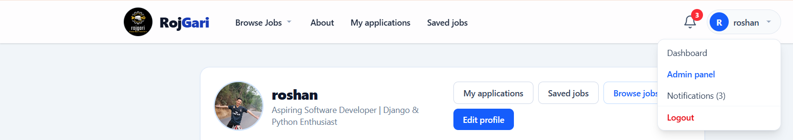
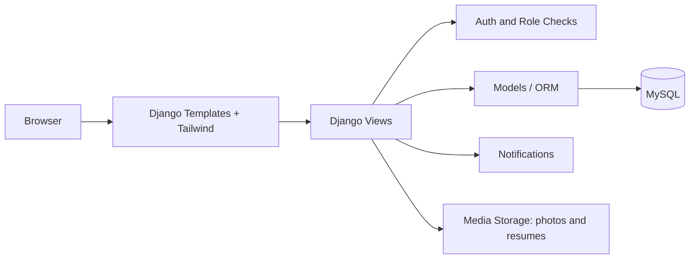
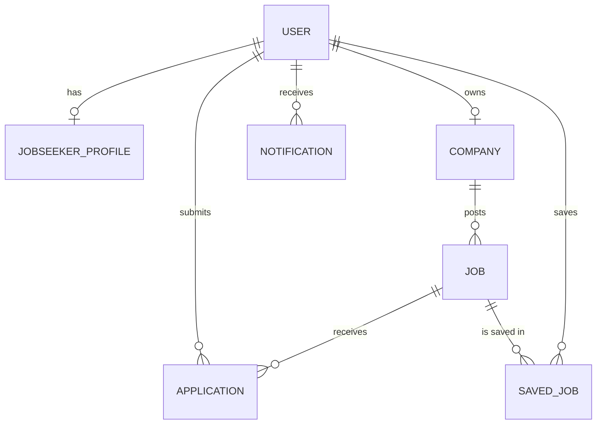

<div align="center">

<h1>RojGari</h1>

<p><b>A role-based job portal for Nepal, connecting job seekers with verified employers.</b></p>


[Live Demo](#) &nbsp;|&nbsp; [Screenshots](#screenshots) &nbsp;|&nbsp; [Features](#features) &nbsp;|&nbsp; [Setup](#getting-started)

</div>


## Overview

RojGari is a full-stack web application with three user roles: **job seekers**, **companies** and **admins**. Job seekers maintain a single profile and resume and apply to jobs. Companies register, are **verified by an admin**, then post jobs and manage applicants. Admins monitor the whole platform from a custom dashboard.

**Why this project:** hiring platforms depend on trust. RojGari adds a company verification step before any job goes live, and keeps every party informed with in-app notifications.

## Highlights

- **Three role-based experiences** (job seeker, company, admin) with separate dashboards and access rules
- **Company verification workflow**: companies are reviewed by an admin before they are trusted on the platform
- **Complete application lifecycle**: apply, track status, receive notifications
- **Profile strength meter** that guides job seekers to complete their profile
- **Secure resume handling**: resumes are served through a protected view, not exposed as open links
- **Custom admin panel** with live statistics, filters, search and moderation actions (block users, deactivate jobs)
- **Relational data model on MySQL 8** using the `utf8mb4` character set
- **Responsive UI** built with Tailwind CSS

## Screenshots

| Login | Register |
| --- | --- |
|  |  |

| Footer |
| --- |
|  |

| Profile and notifications menu | Admin overview |
| --- | --- |
|  |  |

| Admin: user management | Admin: job management |
| --- | --- |
|  |  |

## Features

### Job seekers
- Register, log in and manage a detailed profile: photo, headline, bio, contact, location, education, experience, skills, expected salary and preferred job type
- Skills displayed as tags
- Upload a resume once and reuse it for every application
- Search jobs by organization and filter by Full-time, Part-time, Internship or Remote
- Save jobs and review them later
- Apply to jobs and track each application under *My applications*
- Notification bell with an unread counter

### Companies
- Separate employer registration and login
- Admin verification before the company is trusted
- Post and manage jobs with location, job type and application deadline
- Review applicants and their resumes
- Update application status
- Get notified when a new application arrives

### Admin
- Overview cards: users, companies, pending verification, jobs, open jobs, applications
- Verification queue for new companies
- Recent applications feed
- **Users:** filter by role, search by username or email, block accounts
- **Jobs:** filter by status, search by title, company or location, deactivate listings
- **Companies:** review and verify companies
- Shortcut to the Django admin

## Tech stack

| Layer | Technology |
| --- | --- |
| Language | Python 3 |
| Framework | Django |
| Database | MySQL 8 |
| Frontend | Django Templates, Tailwind CSS |
| Tooling | Git, GitHub, VS Code, npm |

## Architecture



### Data model (simplified)



> This diagram is simplified. Adjust the entity names to match your `models.py`.

## Project structure

```
rojgari/
├── core/             # Shared models, profiles, resume access
├── jobs/             # Job listings, search, saved jobs
├── applications/     # Applications and status tracking
├── dashboard/        # Job seeker, company and admin dashboards
├── notifications/    # In-app notifications
├── templates/        # Django templates
├── static/           # Tailwind source and compiled CSS
├── screenshots/      # README images
├── manage.py
└── requirements.txt
```

> Update this tree so it matches your actual folders.

## Getting started

### Prerequisites
- Python 3.10+
- Node.js and npm (for Tailwind CSS)
- MySQL 8

### 1. Clone

```bash
git clone https://github.com/YOUR_USERNAME/YOUR_REPO.git
cd YOUR_REPO
```

### 2. Create a virtual environment

```bash
python -m venv venv
# Windows
venv\Scripts\activate
# macOS / Linux
source venv/bin/activate
```

### 3. Install dependencies

```bash
pip install -r requirements.txt
npm install
```

### 4. Configure the database

Create the database and user:

```sql
CREATE DATABASE rojgari CHARACTER SET utf8mb4 COLLATE utf8mb4_unicode_ci;
CREATE USER 'rojgari_user'@'localhost' IDENTIFIED BY 'your_strong_password';
GRANT ALL PRIVILEGES ON rojgari.* TO 'rojgari_user'@'localhost';
FLUSH PRIVILEGES;
```

Install the MySQL driver:

```bash
pip install mysqlclient
```

<details>
<summary>mysqlclient fails to install?</summary>

On Linux, install the build dependencies first:

```bash
sudo apt install python3-dev default-libmysqlclient-dev build-essential pkg-config
```

Or use PyMySQL instead:

```bash
pip install pymysql
```

and add to `settings.py`:

```python
import pymysql
pymysql.install_as_MySQLdb()
```
</details>

`settings.py`:

```python
import os

DATABASES = {
    "default": {
        "ENGINE": "django.db.backends.mysql",
        "NAME": os.environ.get("DB_NAME", "rojgari"),
        "USER": os.environ.get("DB_USER", "rojgari_user"),
        "PASSWORD": os.environ.get("DB_PASSWORD", ""),
        "HOST": os.environ.get("DB_HOST", "127.0.0.1"),
        "PORT": os.environ.get("DB_PORT", "3306"),
        "OPTIONS": {"charset": "utf8mb4"},
    }
}
```

### 5. Environment variables

Create a `.env` file in the project root (already in `.gitignore`):

```
SECRET_KEY=your-django-secret-key
DEBUG=True

DB_NAME=rojgari
DB_USER=rojgari_user
DB_PASSWORD=your_strong_password
DB_HOST=127.0.0.1
DB_PORT=3306
```

### 6. Migrate and create an admin

```bash
python manage.py migrate
python manage.py createsuperuser
```

### 7. Run

In one terminal, build Tailwind:

```bash
npx @tailwindcss/cli -i ./static/src/input.css -o ./static/css/output.css --watch
```

In another, start Django:

```bash
python manage.py runserver
```

Open http://127.0.0.1:8000.

## User roles

| Role | Capabilities |
| --- | --- |
| Job seeker | Manage profile and resume, search, save and apply to jobs, receive notifications |
| Company | Register, get verified, post jobs, manage applicants |
| Staff / Admin | Verify companies, manage users and jobs, view platform statistics |

## Notifications

| Event | Recipient |
| --- | --- |
| A job seeker applies to a job | The company that posted it |
| An application status changes | The job seeker |

## Security practices

- Secrets and database credentials are kept in environment variables, never committed
- Django's built-in password hashing, CSRF protection and session handling
- Role checks on dashboards and admin actions
- Resumes are served through a protected endpoint
- Admins can block abusive accounts and deactivate listings

## Testing

```bash
python manage.py test
```

> Add tests for your key flows (registration, applying to a job, company verification) and list the coverage here.

## Roadmap

- [ ] Email notifications for application updates
- [ ] Job alerts based on saved skills
- [ ] Employer analytics (views and applications per job)
- [ ] REST API with Django REST Framework
- [ ] Docker setup and CI with GitHub Actions
- [ ] Deployment with a live demo

> Edit this list to reflect what you actually plan to build.

## What I learned

- Designing a multi-role application with role-based access control
- Modeling relational data and working with MySQL through the Django ORM
- Building file-upload flows for photos and resumes
- Building admin dashboards with filters, search and moderation actions
- Creating a responsive UI with Tailwind CSS
- Writing clear documentation and using Git for version control


